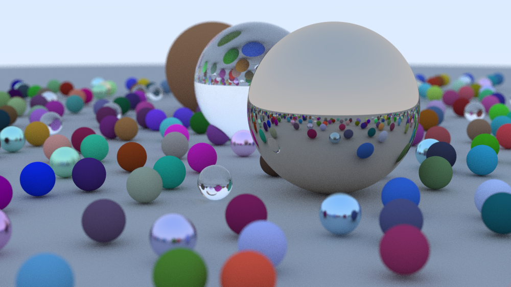

# Ray Tracer

A CPU path tracer written in dependency-free C++17. Supports diffuse, metal and
glass materials, depth of field, a multithreaded tile renderer, and BVH
acceleration. Renders to PNG with no external libraries.



## Build

```bash
cmake -B build -DCMAKE_BUILD_TYPE=Release
cmake --build build -j
```

Without CMake:

```bash
g++ -std=c++17 -O3 -march=native -pthread src/main.cpp -o raytracer
```

## Usage

```bash
./build/raytracer --width 1000 --spp 100 --out render.png
```

| Option | Description | Default |
|--------|-------------|---------|
| `--width N` | image width (16:9 aspect) | 800 |
| `--spp N` | samples per pixel | 50 |
| `--depth N` | max ray bounces | 20 |
| `--threads N` | worker threads (0 = all cores) | 0 |
| `--accel list\|bvh` | acceleration structure | bvh |
| `--grid N` | scene size, about (2N)^2 small spheres | 11 |
| `--out FILE` | output PNG | out.png |
| `--no-output` | skip writing the image (benchmarking) | |

## Performance

The renderer supports three configurations on the same scene:

- **Brute force**: every ray tests every sphere, single thread
- **Multithreaded**: the image is split into 32x32 tiles pulled from an atomic
  counter, so threads that finish cheap tiles (sky) immediately take more work
- **BVH**: a bounding volume hierarchy stored as a flat, depth-first node array,
  traversed with a fixed-size stack (no recursion or heap allocation)

Run `scripts/benchmark.sh` to compare them on your machine.

## Layout

```
src/
  vec3.h       vector math
  rng.h        per-pixel seeded xorshift RNG
  geometry.h   Ray, Sphere, Material, AABB, intersection routines
  accel.h      LinearList and BVH
  camera.h     thin-lens camera
  renderer.h   path tracing loop and tile-based thread pool
  png.h        minimal PNG writer
  main.cpp     CLI, scene generation, timing
scripts/benchmark.sh
```

## Design notes

- **Deterministic output.** Each pixel owns its RNG, so any thread count produces
  byte-identical images. Optimizations can be checked with `cmp a.png b.png`.
- **Templated on the acceleration structure.** `render<World>` lets the compiler
  inline `hit()` rather than going through virtual dispatch.
- **BVH layout.** The left child of a node is always at `index + 1`; leaves own a
  contiguous range of reordered spheres, which keeps traversal cache friendly.
- **Single precision** throughout for lower memory traffic.
